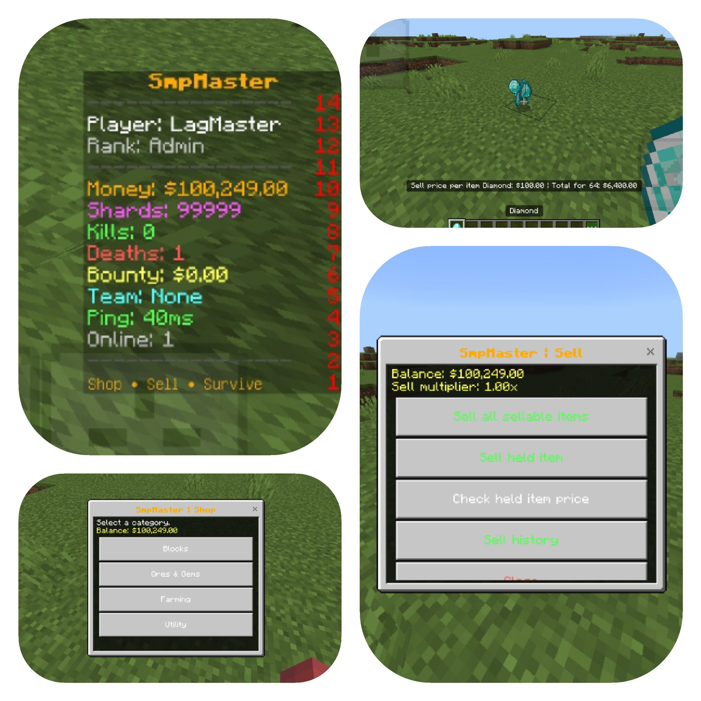
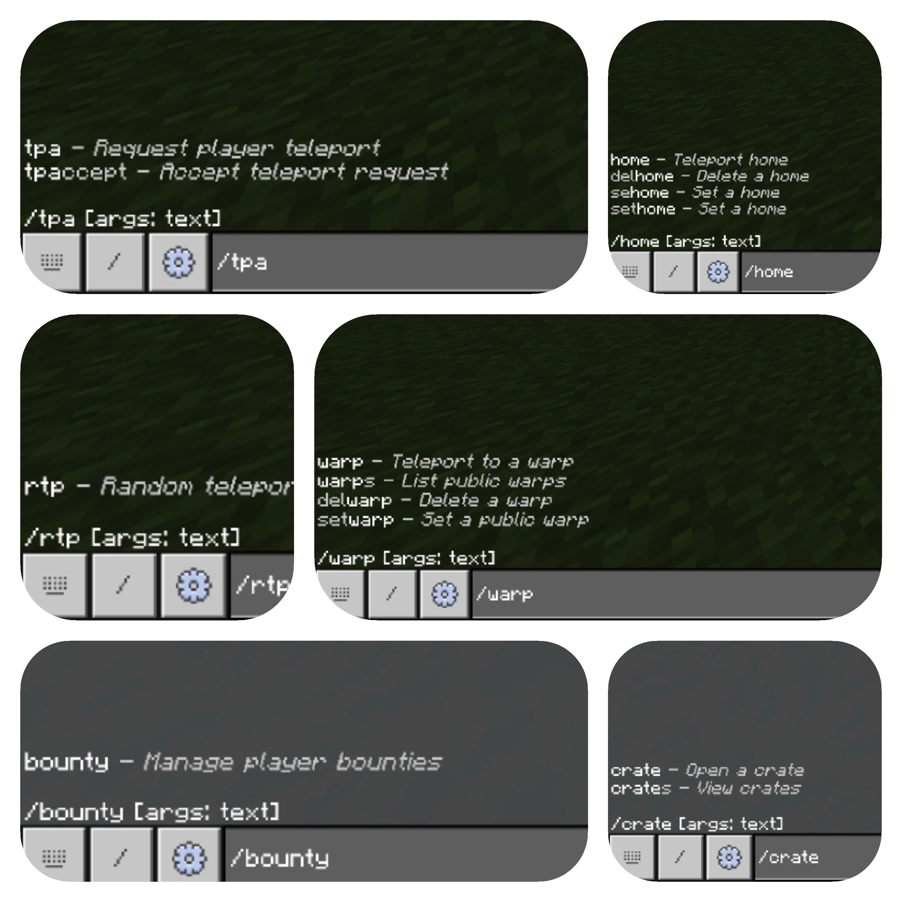

# SmpMaster for PocketMine-MP API 5

  
  

**Version:** 0.4.6 
**Namespace:** `LagMaster\\SmpMaster`  
**Data folder:** `plugin_data/SmpMaster/`

SmpMaster is an independent PocketMine-MP plugin for a Donut-style Bedrock survival economy. It is not the original Java plugin and does not include its source code or assets.

## Features

- Internal SQLite economy: `/money`, `/bal`, `/pay` and operator management commands.
- Shards currency: `/shards`, `/shardpay`, `/setshards`.
- Configurable category-based `/shop`.
- `/sell`, `/sellhand [amount]`, `/sellall`, `/worth [hand]`, `/sellhistory`, and sell multipliers.
- Automatic per-item sell prices for ordinary vanilla survival items, with explicit overrides in `worth.yml`; the held item's unit and stack total appear in the action bar.
- Persistent fixed-price auction house: `/ah`, `/ah sell <price> [amount]`, `/ah my`, `/ah cancel <id>`, `/ah claims`.
- SQLite transaction for auction purchase settlement and a persistent item-claim queue for purchased, cancelled and expired listings.
- Configurable auction limits, lifetime, price range, page size and blocked items.
- Scoreboard, stats, playtime and leaderboards.
- Bounties, homes, warps, spawn, RTP, TPA, basic teams, virtual-key crates, reports and help requests.
- English text is sent directly to Minecraft forms, action bars and the scoreboard without RTL text mangling. Missing or empty bundled config files are regenerated on startup.

## Install

1. Stop PocketMine-MP.
2. Put `SmpMaster.phar` in the server's `plugins/` folder.
3. Start the server and confirm the plugin enables.
4. Configure `config.yml`, `shop.yml`, `worth.yml`, `auction.yml`, `scoreboard.yml` and `crates.yml` inside `plugin_data/SmpMaster/`.
5. Back up `plugin_data/SmpMaster/` and its SQLite database before upgrading. Restart after configuration changes, or use `/smp reload` for supported YAML changes.

SmpMaster uses PHP's `SQLite3` extension and does not require EconomyAPI or FormAPI. The PocketMine PHP build must include `SQLite3`.

## Core commands

- Economy: `/money [player]`, `/pay <player> <amount>`, `/shards`, `/shardpay <player> <amount>`
- Shop and sales: `/shop`, `/sell`, `/sellhand [amount]`, `/sellall`, `/worth [hand]`, `/sellhistory`, `/sellmulti`
- Auction house: `/ah`, `/ah sell <price> [amount]`, `/ah my`, `/ah cancel <id>`, `/ah claims`
- Survival: `/sethome`, `/home`, `/delhome`, `/setwarp`, `/warp`, `/warps`, `/setspawn`, `/spawn`, `/rtp`, `/tpa`, `/tpaccept`, `/tpdeny`
- Other: `/stats`, `/leaderboard`, `/bounty`, `/team`, `/crates`, `/crate`, `/report`, `/helpop`, `/cleardrops`, `/smp help`, `/smp reload`

## Price behaviour

Entries in `worth.yml` override automatic prices. Otherwise, SmpMaster tries `auto-prices` by matching item-name fragments and then falls back to `default-sell`. This means ordinary vanilla blocks, drops and items normally have a sell price; protected admin/technical blocks such as command blocks, barriers and bedrock are denied even if someone adds them to the explicit price list. `/sellall` scans the main inventory, not armor slots or off-hand storage. Prices are per item; the held-item action bar displays the per-item price and the held stack's total, including the current sell multiplier.

The auction house stores fixed total prices per listing. On purchase, payment to the seller, deduction from the buyer, removal of the listing and creation of a buyer claim are grouped in a SQLite transaction. Purchased items are collected via `/ah claims`; cancelled and expired listings are also returned through that claim queue. The server's inventory and SQL database cannot participate in one cross-system atomic transaction, so keep backups and test updates on a staging server first.

## Dropped item cleanup

`/cleardrops` removes dropped item entities from all loaded worlds and is OP-only by default (`smpmaster.admin.cleardrops`). Automatic cleanup is enabled by default and runs every 120 seconds (2 minutes) by default. Change `settings.drops.auto-clear`, `settings.drops.interval-seconds`, and `settings.drops.announce` in `config.yml` to tune it. Only dropped item entities are removed; player inventories and containers are not touched.

Deleting the whole `plugin_data/SmpMaster/` folder also deletes `smpmaster.sqlite3`, which contains balances, stats, homes, teams, auction listings and pending claims. To reset English config files while preserving game data, stop the server and remove only the YAML files; keep the SQLite database.

## Scope and testing

This is an independent implementation, not a one-to-one clone of every UltimateDonutSMP system. A full Orders order book, ranked duels/FFA, Redis/Discord cross-server synchronization, and complete staff-mode tooling are not included in this version.

PHP syntax, YAML structure, English-only runtime resources, required PHAR entries, command registration, and archive integrity were checked. The container did not have a PocketMine runtime or the PHP SQLite3 extension available, so the plugin could not be booted and fully integration-tested here. No bug-free guarantee is possible; test on your exact PMMP build before production use.

### 0.4.3 hotfix (historical)
- Fixed PHAR resource packaging so default YAML files are stored under `resources/` as required by PocketMine.
- Added built-in fallback shop categories and scoreboard lines for empty config files; shortened the scoreboard objective identifier for Bedrock client compatibility.
- Hardened saved-home/world teleport handling and accepted `/sehome` as an alias for `/sethome`.

RTP note for 0.4.3: that build attempted to skip ungenerated chunks but used a method unavailable in PocketMine API 5, so RTP could silently fail. Version 0.4.4 corrects the method call and uses player-relative coordinates; it searches already-generated terrain and does not synchronously generate thousands of chunks.

## Version 0.4.4 — debugging fixes

- Fixed RTP chunk checks for PocketMine API 5 using `isChunkGenerated()` and player-relative coordinates.
- Scoreboard money now reads the canonical SQLite balance and updates immediately after sales/purchases.
- Dropped items are cleared every 120 seconds; players receive a bottom-screen popup with the cleanup result.
- Existing plugin data is preserved; config migration is one-time.

## Version 0.4.5 — debugging release

- Economy: every new account now receives the configured `settings.starting-money`; read-only commands (`/money`, `/shards`, `/stats`, scoreboard) no longer create empty 0-balance accounts for unknown names; `/pay` and `/shardpay` refuse unknown names instead of silently moving money into a ghost account. Existing balances are never modified.
- Scoreboard: adds `%team%` (existing team system, or `None`) and `%ping%` (`NetworkSession::getPing()`); old `scoreboard.yml` files are upgraded once (backup `scoreboard.yml.bak-0.4.4`); values refresh immediately after payments, kills, deaths, bounties and crates.
- Teleports: `/rtp`, `/home`, `/warp` and accepted `/tpa` now use a 5-second countdown (`settings.teleport.countdown-seconds`) with tip text and sounds. Moving cancels it, camera rotation does not. One countdown per player; quit/death/new request cancel the old one safely. `/spawn` is unchanged (instant).
- Ground-item cleanup: still every 120 s; only `ItemEntity` is removed; popup + sound; tasks and commands are cleaned up on disable.
- New admin command: `/smp debug <player>` prints the stored database row for diagnosing scoreboard values.

## Version 0.4.6
- Scoreboard now re-sends the objective whenever a value changes (Bedrock ignores text changes on existing rows), fixing stuck Money/Kills/Deaths/Team/Ping values.
- Kill credit also uses the last player who hit the victim within 15 s; Team rows refresh on team create/join/leave; sidebar is re-sent after respawn.
- Startup log prints the plugin version and database path.
